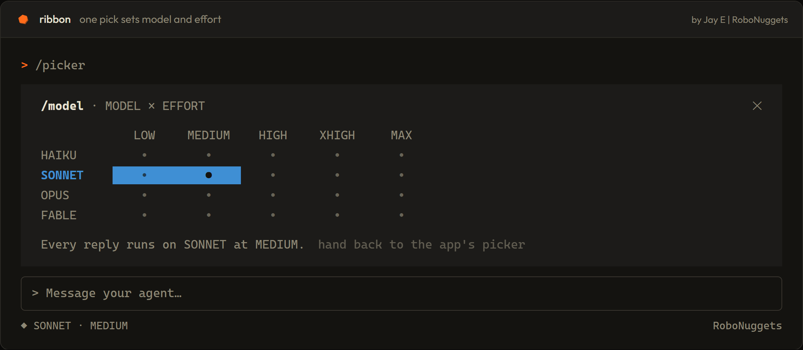
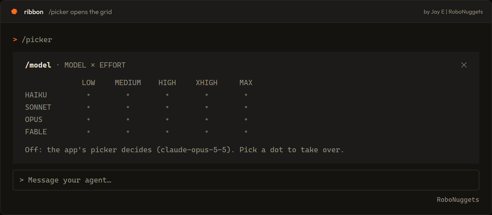
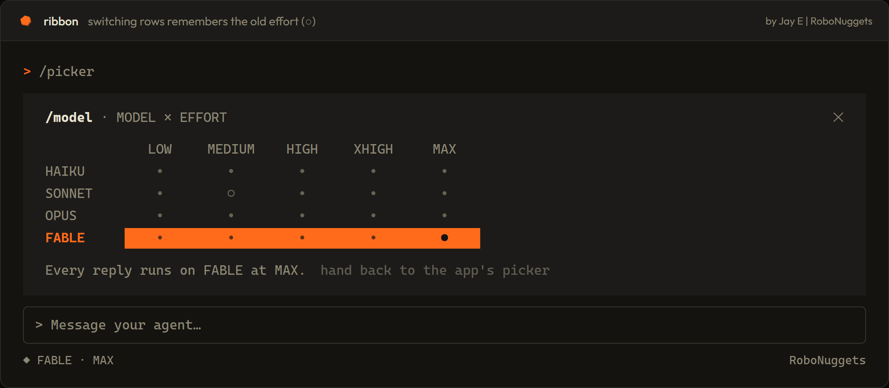

<p align="center">
  
</p>

# ribbon

A free mod for Claude Code. It puts a model by effort ribbon above your prompt. Pick one dot, and every reply in the main chat runs on that model at that effort.

No menus. No typing model names. One dot.

<p align="center">
  
</p>

## Install

You need Claude Code with mods turned on. This is the one-line install.

In a Claude Code terminal session, type:

```
/plugin install ribbon --marketplace robonuggets/ribbon
```

Or run it from a shell:

```
claude plugin install ribbon --marketplace robonuggets/ribbon
```

Then:

1. Type `y` when it asks `Add marketplace?`.
2. Pick the **user** scope with Enter.
3. Wait for `Installed ribbon. Plugin is now active.`

It works in that session right away. It also loads in every session you start after that.

If you use the desktop app, `/plugin` does not run there. Click **+** next to the prompt box, then **Plugins**, then **Add marketplace**, and enter `robonuggets/ribbon`. Then click **Add plugin**.

### For agents

If you are an agent installing this for a user, run the shell line above. Then tell the user to restart their session if `/picker` is not listed. Do not edit their settings file by hand.

## Use it

1. Type `/picker`. The ribbon opens above the prompt.
2. Click a dot (or press it). The row is the model. The column is the effort.
3. Send your next message. It runs on your pick.

<p align="center">
  
</p>

To give control back to the app, type `/picker off`. You can also click **hand back to the app's picker** in the ribbon.

Your pick is saved. It is still there next session. The status line shows it, for example `◆ SONNET · MEDIUM`.

### Switching models remembers your effort

If you move from one model to another, the ribbon remembers the effort the old row had. It shows it as a hollow dot (○). Move back and your old effort is a click away.

<p align="center">
  
</p>

## What it changes (and what it does not)

- It changes the model and effort of every request in your main chat.
- It does not change subagents. They keep the model they were started on.
- It wins over the app's own model picker until you hand back.

## Models in the ribbon

| Row | Model ID |
| --- | --- |
| HAIKU | `claude-haiku-5-5` |
| SONNET | `claude-sonnet-5-5` |
| OPUS | `claude-opus-5-5` |
| FABLE | `claude-fable-5-1` |

Columns are `low`, `medium`, `high`, `xhigh` and `max`. If a model ID changes, edit `MODEL_IDS` at the top of `hooks/register.tsx`.

## What is inside

```
ribbon/
├── .claude-plugin/
│   ├── plugin.json         the mod's name and version
│   └── marketplace.json    makes this repo installable
├── hooks/
│   ├── hooks.json          points to the module
│   └── register.tsx        the ribbon, the /picker command, the model rewrite
├── types/index.d.ts        the type of the saved pick
├── tests/grid.test.ts      a test: press a dot, check the request
└── assets/                 banner, screenshots, hex icon
```

The screenshots are rendered from the ribbon's own layout, colours and glyphs in `hooks/register.tsx`.

## Remove it

```
/plugin uninstall ribbon
```

## Develop it

Load the folder without installing it:

```
claude --plugin-dir ./ribbon
```

Run the test:

```
claude plugin test ./ribbon
```

## License

[CC BY 4.0](LICENSE). Use it, change it, share it. Keep the credit.

Made by Jay E from RoboLabs. Learn more at [RoboNuggets](https://robonuggets.com).

<p align="center">
  
</p>
