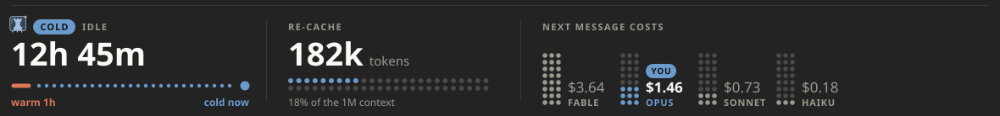

<p align="center">
  
</p>

<p align="center">
  
  
  
</p>

---

A free, open-source mod for Claude Code. It adds one slim band above your prompt that shows:

| | **Usage** | **Prompt cache** |
|---|---|---|
| What | How much of your 7-day and 5-hour windows is **left**, when each resets, and **when you'll run out** at your current pace | Whether the cache is **warm** or **cold**, what your next message costs, a **warning before it goes cold**, and **what you've spent** today |
| Where it comes from | The app's own rate-limit figures | The time of your last request, the size of your chat, and the session's `/cost` total |
| Cost | Nothing: it never calls a model | Nothing |

It installs once and shows in every session after that. No commands to learn.

## Install

In Claude Code, type:

```
/plugin install tokenite --marketplace Adztrz/tokenite
```

1. Type `y` when it asks `Add marketplace?`.
2. Pick the **user** scope with Enter.
3. Start a new session.

Agents can run the same thing in a shell:

```
claude plugin install tokenite --marketplace Adztrz/tokenite
```

## What you see

### ● Usage left

- **7D** is your 7-day window, **5H** your 5-hour window.
- Each dot bar shows what is **left**, not what is used.
- Next to each one is when it resets, for example `· 3d 9h`.
- Under 15% left, a bold **LOW** appears.
- **Forecast:** if you're on pace to use a window up before it resets, the band adds when you'll run out, for example `· out ~1h 40m · ↻ 4h 57m`, with the reset time still beside it. The pace is read from the last hour of readings and carries over between sessions. The 7-day forecast also waits out each 5-hour reset: when your pace would use up the 5-hour window, the week only moves again once it resets.

### ● The prompt cache

After your first reply the band also tracks the prompt cache, which keeps your chat cheap to continue for one hour after your last request.

- **WARM** (orange, the crystal bobs): the cache is live. It shows the minutes left.
- **COLD** (blue, the crystal is frozen in ice): the hour has passed. Your next message re-sends the whole chat, so it costs more. The price shows first.
- **The crystal is a gauge.** A pixel quartz in Claude's oranges, it stands as full as your 5-hour window has left, one pixel row at a time, and drains as you work.
- **Heads-up before it goes cold.** Five minutes before the hour is up, a toast says what sending now saves, for example *"Cache goes cold in 5m. Send now and the next message costs $0.04, not $1.46."*
- **Spend.** The card's footer shows what this session and today have cost so far. Today's total adds up across all your sessions.

Click **Show** to open the cache card and **Hide** to fold it. Warm starts folded; cold starts open, so you see the price before you send.

<p align="center">
  
</p>

<p align="center">
  
</p>

### ● Fits any width

- **Wide:** everything on one row.
- **Half width:** each window stacks into a small block.
- **Narrow:** the cache moves to its own row.
- **Terminal:** the same facts as plain text.

## Good to know

- **Prices are estimates.** Next-message prices come from the `MODELS` table in `hooks/cache-art.ts`, not from your bill. If prices change, edit that table.
- **Spend is what `/cost` reports.** On a subscription that's what the same use would cost on the API, not what you're charged.
- **Subagents don't count.** Only your main chat resets the cache clock.

## What is inside

```
tokenite/
├── .claude-plugin/
│   ├── plugin.json         the mod's name and version
│   └── marketplace.json    makes this repo installable
├── hooks/
│   ├── hooks.json          points to the module
│   ├── register.tsx        the band: usage, cache tracking, layout
│   ├── cache-art.ts        colours, the crystal gauge, the cache card, the price table
│   ├── forecast.ts         when a window runs out at your current pace
│   ├── spend.ts            today's spend across sessions
│   └── font.ts             Outfit, embedded so the drawings render anywhere
├── types/index.d.ts        the shape of what the band remembers
├── tests/                  12 tests: layouts, warm and cold, terminal, forecast, warning, spend
└── assets/                 banner, mark, cache card renders
```

## Develop it

Load the folder without installing it:

```
claude --plugin-dir ./tokenite
```

Run the tests and checks:

```
claude plugin test ./tokenite
claude plugin validate ./tokenite
```

## Remove it

```
claude plugin uninstall tokenite
```

## License

[MIT](LICENSE). Based on [ribbon](https://github.com/robonuggets/ribbon), also MIT.

The embedded font is [Outfit](https://github.com/Outfitio/Outfit-Fonts), under the SIL Open Font License 1.1.

<p align="center">
  <picture>
    <source media="(prefers-color-scheme: dark)" srcset="assets/mark-light.svg">
    
  </picture>
</p>
